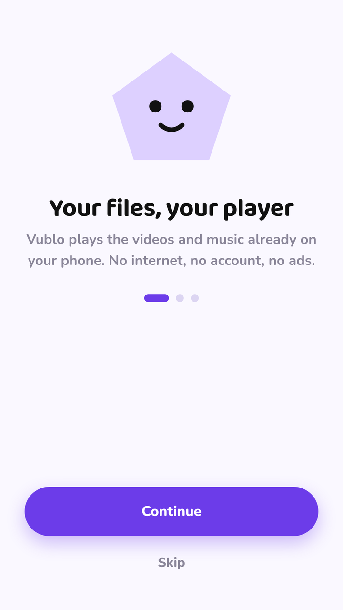

# Vublo: Your files, your player

Vublo is a lightweight, local-first media player for downloaded video and audio files on the phone. No internet, no streaming, no account, no ads.

## What it does

- Import local video and audio files, or a whole folder, from the device file picker, with duplicate detection by file name plus size.
- Fast searchable library for videos and music, with sorting and filters for favourites, unfinished, and finished files.
- Full video player with resume, playback speed, subtitles from .srt or .vtt files, and picture-in-picture.
- Full audio player with queue, shuffle, repeat, sleep timer, and a 5-preset equaliser.
- Playlists and favourites, with two empty editable playlists seeded: Travel Videos and Workout Mix.
- Lavender, white, and purple design with pastel cards and SVG blob mascots.
- Works fully offline. All data is stored only on the device, and the library starts empty by design, with no fake files.

## Status

Working prototype, built November 2026. A signed Android APK also exists (Vublo.apk, 397K, package com.yashdashrath.vublo, debug-signed, targetSdk 35). No Play Store claim.

## Showcase only

This repository is a showcase. It contains no source code and no build files, and nothing here is open source. The screenshot(s) above are showcase images only. See NOTICE.md.

## Contact

Built by Yash Dashrath, Pune, India.

- Email: yashdashrath18@gmail.com
- LinkedIn: https://www.linkedin.com/in/yash-dashrath
- Yash MediaWorks: https://www.linkedin.com/company/yashmediaworks/
